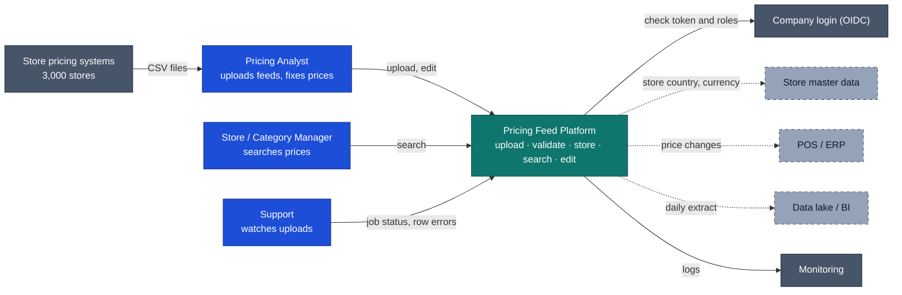

# 1. Context Diagram

The Pricing Feed Platform holds store-level prices for the whole chain. Analysts upload CSV feeds, store and category managers search them, and pricing staff fix mistakes.

Solid lines are built. Dashed lines are planned integrations and are out of scope here.

| Who | What they do | Role |
|---|---|---|
| Pricing analyst | Uploads feeds, reviews rejected rows, fixes prices | uploader, editor, viewer |
| Store / category manager | Searches prices | viewer |
| Support | Checks upload status and failures | viewer |

**In scope:** CSV upload and validation, saving prices, safe re-uploads, search, editing with conflict checks, change history, login and roles.

**Out of scope:** price approvals, promotions, sending prices to POS, store master data, currency conversion.
