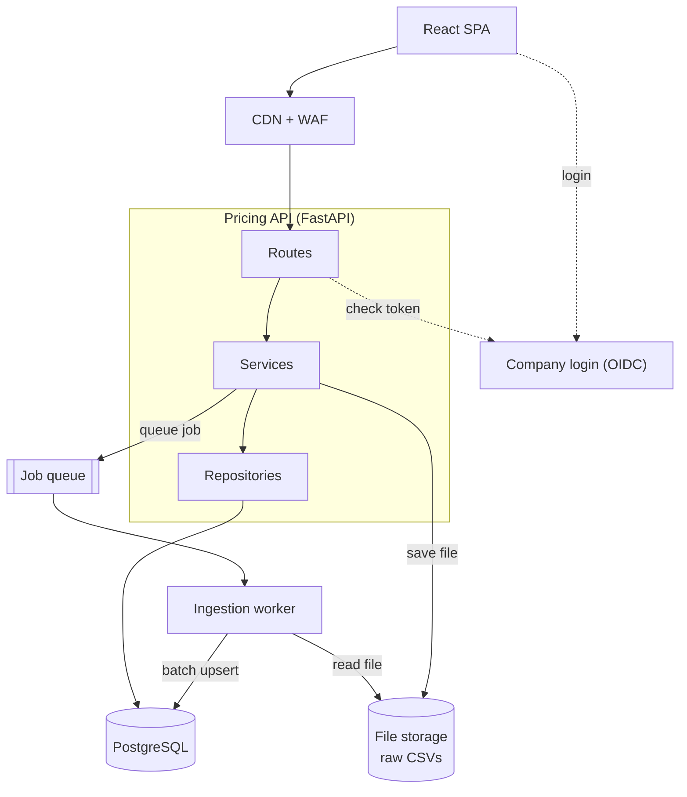
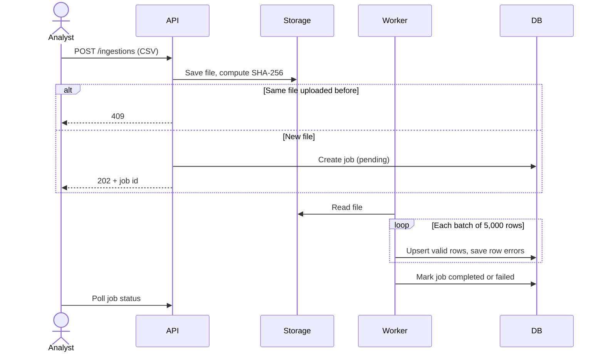
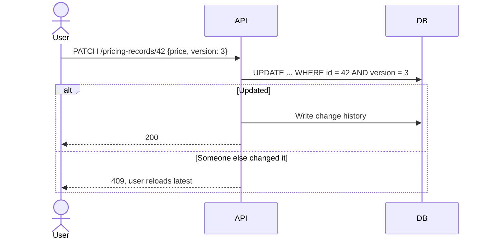
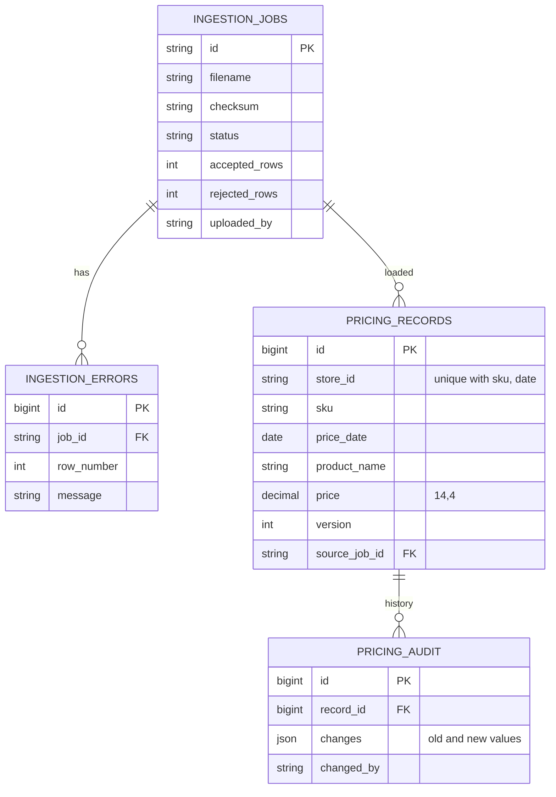
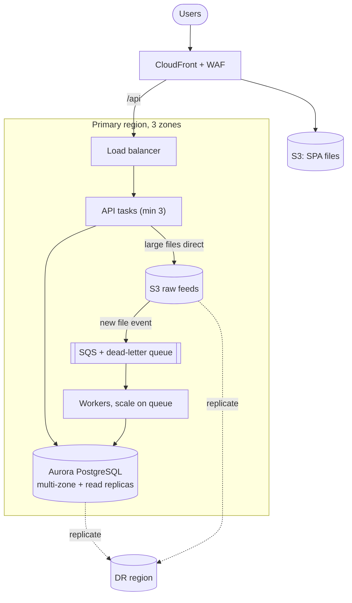

# 2. Solution Architecture

## Components

| Part | Job | In this repo |
|---|---|---|
| React SPA | Upload, upload history, search, edit, change history | `frontend/` |
| Pricing API | REST endpoints, validation, login and roles | `backend/app` |
| Ingestion worker | Reads the CSV, checks each row, saves in batches of 5,000 | `services/ingestion.py` |
| File storage | Keeps every uploaded file | Local disk (S3 or Blob in production) |
| Job queue | Separates upload from processing | FastAPI background tasks (SQS or Service Bus in production) |
| Database | Prices, uploads, history | PostgreSQL, SQLite for tests |

The code is layered as routes, then services, then repositories. Each layer only calls the one below it.

## Upload flow

## Edit flow

## Data model

Indexes follow the common searches: store + date, SKU + date, date alone, and a trigram index for "product name contains".

## Production deployment

AWS is shown here. Azure has a matching service for each part.

| | This repo | Production |
|---|---|---|
| Processing | Background task in the API | Separate worker reading from a queue |
| Big files | Sent through the API, up to 512 MB | Uploaded straight to S3 |
| Storage | Local disk | S3 or Blob, same interface |
| Database | One PostgreSQL | Managed PostgreSQL, replicas, monthly partitions |

If some countries require data to stay inside their borders, the same build can run as separate regional deployments, one per region.
